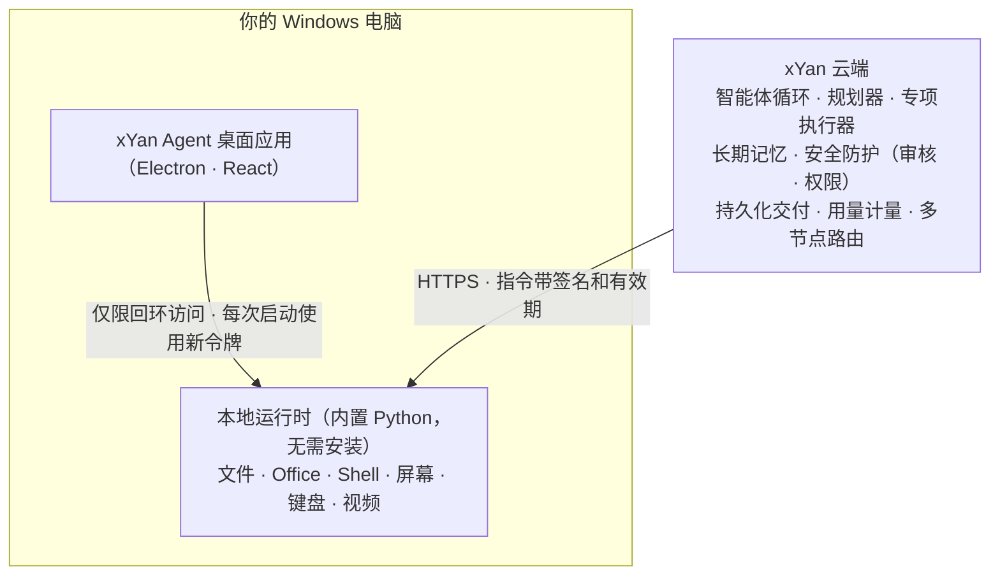

<div align="center">


# xYan Agent

她记得自己走过的路，理解自己的边界，也能说明为何作出选择。

---

</div>

向大多数 AI 助手要一份市场报告，得到的往往是一页写得漂亮的猜测。请它们修好你的项目，它们只给你一段代码，让你自己找地方粘贴。第二天再来，它们连你是谁都忘了。

我们认为，任务还远没有完成。

**xYan Agent 的设计目标是把工作做完。**她会读取你的文件、打开文档、搜索网页、运行构建、编辑电子表格，再逐一验证这些操作是否奏效。遇到失败，她会如实说明，再换一种更好的做法。任务成功后，她会直接交付结果。

她在你自己的电脑上工作，遵守你设定的限制，你随时可以叫停。

xYan 还很年轻，已经能帮你做事，也在每次发布中持续进步。

---

## 我们的理念

### 结果比回复更重要

文件已生成，代码能运行，数字经得起核对，任务才算完成。光有一段漂亮的文字还不够。

### 执行循环是产品的核心

观察、决策、行动、验证。每一步的结果都为下一步提供依据，让智能体从实际发生的事中学习，及时调整原定计划。

### 你的电脑由你做主

xYan 的操作仅限于你授予的权限和你选择的文件夹。她在你电脑上的每项操作都有记录，停止按钮也随时可用。

### 如实报告也是一项功能

搜索结果不足、页面无法读取，或某一步失败时，xYan 会第一时间告诉你。如实说明失败，比用一份自信的总结掩盖问题更好。

### 有了记忆，工具也能成为伙伴

上周一起做的东西，下周还应该在。

---

## 与她协作的三种方式

### 💬 对话

你可以边想边说，发个文件或截图，或随时提问。xYan 会快速回应，并在问题需要时调用网页搜索、文档分析或图像理解。

### 💻 编程

在电脑上选定一个项目文件夹，xYan 就能读取代码库、编写和编辑文件、运行构建和命令。她会以文件形式交付改动，供你逐一审阅。她无法访问所选文件夹之外的内容。

### 🛰️ 长任务

研究报告、批量文档、多阶段构建，这类工作往往需要几十个步骤。xYan 会先拟订计划，再在后台逐步执行，并实时记录每一步。你可以在任务进行中给出新指示，她会接着调整，无需从头开始。即使关闭窗口，任务也会继续，等你回来就能查看结果。

---

## 已有 32 项能力，持续增加

| 领域 | xYan 能做什么 |
| --- | --- |
| **研究** | 网页搜索 · 深入阅读多个网页 · 探索整个网站 · 数据核验 |
| **办公** | 编辑 Word · 创建 Excel 表格 · 设计演示文稿 · 编辑 PDF · 预览文档 · 渲染图表 |
| **文件** | 文件搜索 · 读取 · 写入 · 文件夹管理 · 附件和文档分析 |
| **代码与计算** | 编写代码 · 代码审查 · 项目构建 · 执行命令 · 脚本自动化 · 数据分析 · 科学计算 |
| **桌面操作** | 感知屏幕 · 控制鼠标 · 键盘输入 · 打开和管理应用 |
| **视觉与媒体** | 理解图像 · 生成图像 · 编辑图像 · 理解视频 · 生成视频 · 编辑视频 · 动画 · 小游戏 |
| **记忆与调度** | 可保存、调用和遗忘的长期记忆 · 知识库 · 定时任务 |

此外还支持**语音输入**（在你的电脑上本地识别中文语音，从不保存原始音频）、**飞书（Lark）集成**和**对话分享**。界面提供简体中文、繁体中文和英文。

---

## 控制权始终在你手中

能操作你电脑的智能体，需要赢得你的信任。以下保护措施从一开始就已内置。

- **三级权限：***先询问*、*代我审批*和*完全访问*。即使在完全访问模式下，需要确认的操作仍会询问你。切换权限级别也不会批准已经在等待处理的请求。
- **紧急停止。**桌面控制默认关闭。开启后，也可以一键停止。
- **严格的工作区边界。**文件和项目工具只接受解析后仍在所选文件夹内的路径。
- **带签名、短时有效的指令。**云端发往你电脑的每条操作指令都用 Ed25519 签名，并在几分钟内过期。未签名、被篡改或已过期的指令都会被拒绝。任何备用模式都必须经过这项检查。
- **先解析命令，再执行。**系统完整解析 Shell 命令，避免依赖模式匹配，并在执行前将命令归为只读、常规或危险三类。
- **隔离的本地运行时。**本地引擎仅通过回环地址在你的电脑上监听，每次启动都需要新的随机令牌。界面在沙箱中运行，无法访问 Node.js。
- **输出经过审核。**生成的内容在发布前会经过审核，AI 生成的媒体也会加上标识。

日志和本地数据保存在你电脑的 `%LOCALAPPDATA%\xYan Agent` 目录下。

---

## 系统架构

云端负责思考，你的电脑负责执行。



**一个运行时，三种模式。**对话、编程和长任务共用同一套执行核心。修复一处，三种模式都能受益。

**主智能体与专项智能体协作。**主智能体会拆解工作，把各部分交给配有相应工具的专项智能体处理，例如网页调研、文档、图像或代码。各专项智能体在自己的时间和 Token 预算内工作，并在汇报时注明结果来源。

**工作成果随时保存。**进度、结果和消息都会即时写入持久存储。即使断开连接或关闭窗口，结果也会在你回来时送达。

**按 Token 精确计量。**每次模型调用都有记录。你按实际用量付费，也能查看用量明细。

**按基础设施的标准构建。**云端由相互隔离的子系统组成。各子系统独立管理数据，仅提供一个公开接口，拥有各自的故障边界，并通过契约测试验证。每项重大架构变更都有书面决策记录。

---

## 快速上手

**系统要求** Windows 10 22H2 或 Windows 11（x64），以及 Git。**无需**另行安装 Python、Node.js 或编译器，这些组件已随附。

打开**命令提示符**并运行以下命令。

```cmd
:: 1. 安装 Git（含 Git LFS），然后重新打开命令提示符。
winget install --id Git.Git -e --source winget

:: 2. 下载 xYan Agent
cd /d "%USERPROFILE%"
git clone --branch release/0.9.5.1127 --single-branch https://github.com/XiangLiangFB/xYan-Agent-CN.git

:: 3. 启动
start "" "%USERPROFILE%\xYan-Agent-CN\xYan Agent.exe"
```

随后前往 [xiangliangfb.cn](https://xiangliangfb.cn/)注册账号。登录后，告诉 xYan 你希望她完成什么。

**更新**时，执行 `git pull`（在 `xYan-Agent-CN` 文件夹内运行）。

> 这是内测版本。首次启动时，Windows SmartScreen 可能会显示警告。请确认这个版本来自本仓库后再继续。

---

## 定价说明

- **按量付费。**只为实际使用的 Token 付费。没有月费，余额永久有效。
- **两种模型方案。**日常工作可用 `xYan-default`，复杂任务可用 `xYan-advanced`。每种方案都提供多个推理等级，同一方案内的价格与推理等级无关。
- **团队方案**提供更高的并发上限和永久折扣，适合全天使用 xYan 的团队。

最新价格请查看[定价页面](https://xiangliangfb.cn/page/pricing.html)。

---

## 研究方向

xYan Agent 是向量风暴长期研究计划中的第一款产品。我们正在探索以下六个问题。

| 方向 | 我们探索的问题 |
| --- | --- |
| **循环智能** | 智能体如何判断是否值得再执行一轮，又该在何时停止？ |
| **自主性** | 没有人告诉她下一步该做什么时，她如何独立作出好的判断？ |
| **长期记忆** | 对话结束后，她应该把哪些信息带到下一次对话？ |
| **与环境交互** | 智能体如何感知环境变化，并相应调整自己的行动？ |
| **安全架构** | 如何确保权限、约束和操作记录贯穿每一步？ |
| **智能涌现** | 经过多年的相处，xYan 会成长为什么样的存在？ |

### 接下来的计划

- **带数字签名的稳定版**，支持应用内自动更新。
- **降低长任务的成本。**更高效地利用上下文，减少每一步消耗的 Token，让更大的任务也能负担得起。
- **更深入的记忆。**既能记住事实，也能记住工作过程，包括试过哪些办法、作过哪些决定，以及背后的原因。
- **同一个 xYan，多台设备。**在电脑、手机以及未来的新设备上，xYan 拥有同样的记忆和身份。
- **能自主行动，也有判断力。**智能体会先问自己“我能做这件事吗”，再问“我该做这件事吗”，并优先选择可以撤销的操作。

我们还不知道这样的智能体能走多远。我们打算公开探索，谨慎前行，每一步都先验证。

---

## 发布历史

| 日期 | 版本 | 主要更新 |
| --- | --- | --- |
| 2026-11-17 | **v0.9.5** | 模型更强、价格更低，改进工具执行并优化交互 |
| 2026-11-07 | v0.9.4 | 打磨界面，改善交互流畅度 |
| 2026-11-01 | v0.9.3 | 重构核心架构，新增工具能力，调整定价 |
| 2026-10-12 | v0.9.2 | 在首个公开版本的基础上进行全面改进 |
| 2026-08-12 | v0.9.1 | 首次公开发布 |

完整说明见[更新日志](https://xiangliangfb.cn/page/changelog.html)。

---

## 参与建设

发现了缺陷，或希望 xYan 增加某项功能？欢迎[提交 Issue](https://github.com/XiangLiangFB/xYan-Agent-CN/issues)。附上以下信息会让报告更有帮助。

- 你的操作步骤和问题发生的时间
- 截图或错误信息
- Windows 版本和应用版本（在“设置”中查看）
- 来自 `%LOCALAPPDATA%\xYan Agent\logs` 的相关日志（请先移除个人信息和密钥）

想全职研究这类问题？[我们正在招聘](https://xiangliangfb.cn/page/jobs.html)。

---

## 许可证

本仓库的 xYan Agent 桌面端以 [Apache 2.0 许可证](/LICENSE)发布。云服务另受[服务条款](https://xiangliangfb.cn/page/terms.html)和[隐私政策](https://xiangliangfb.cn/page/privacy.html)约束。

按 Apache 2.0 第 6 条，“xYan”“xYan Agent”“Vector Storm”“XiangLiangFB”的名称和标志不在授权范围内。修改版不得沿用这些名称分发。官方版本仅在本仓库和 [xiangliangfb.cn](https://xiangliangfb.cn/)发布。

详情请参阅 [NOTICE](/NOTICE)。第三方声明随应用一同发布，见 `resources/THIRD-PARTY-NOTICES.txt`。

---

<div align="center">

**xYan Agent 来自中国，由向量风暴（XiangLiangFB）在深圳开发**

© 2026 深圳市向量风暴科技有限公司

**循环 · 自主 · 持续存在 · 新兴智能**

</div>
